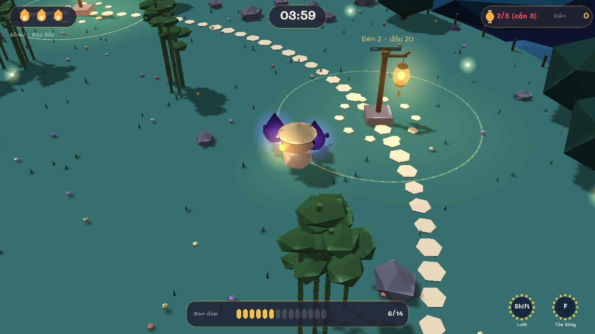
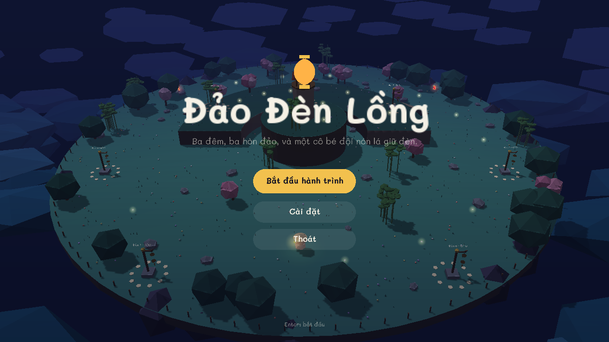

# Đảo Đèn Lồng

> Video demo: [docs/demo/demo.mp4](docs/demo/demo.mp4) (hoặc file đính kèm [Release v1.0.0](https://github.com/daothithuphuong-1801/K5-L3A-DAY12-DaoThiThuPhuong-2A202603457-AI-SDLC-Dao-Den-Long/releases/tag/v1.0.0)) · [CHANGELOG](CHANGELOG.md) · [Retro](docs/retro.md) · Bằng chứng: [P1](docs/proof/phase1/README.md) · [P2](docs/proof/phase2/README.md) · [P3](docs/proof/phase3/README.md) · [P4](docs/proof/phase4/README.md) · [ADR 0001](docs/adr/0001-lantern-fuel-and-dawn-win.md) · Đề lab: [LAB.md](LAB.md)

Game 3D góc nhìn thứ ba qua 3 Đêm. Bạn điều khiển Mây, cô bé giữ đèn đội nón lá, gom đom đóm để thắp và châm dầu cho các Đèn Lồng Lớn. Mục tiêu là giữ đảo sáng tới bình minh, trong khi Bóng Mực tìm cách hút dầu đèn và Gió Lạc rình cướp đom đóm.




## Yêu cầu hệ thống
- macOS 12+, Linux (X11/Wayland có OpenGL) hoặc Windows 10/11.
- Python **3.10 trở lên** (nếu chạy từ mã nguồn).
- GPU hỗ trợ OpenGL 3.2+, RAM 4 GB. Cửa sổ mặc định 1280×720.

## Cài đặt và chạy (tối đa 3 lệnh)

```bash
git clone https://github.com/daothithuphuong-1801/K5-L3A-DAY12-DaoThiThuPhuong-2A202603457-AI-SDLC-Dao-Den-Long.git && cd K5-L3A-DAY12-DaoThiThuPhuong-2A202603457-AI-SDLC-Dao-Den-Long
python3 -m pip install -r requirements.txt
python3 -m game.app
```

Cách khác:
- Chạy `./run.sh` (macOS/Linux) hoặc `run.bat` (Windows). Script tự tạo môi trường ảo ở lần chạy đầu rồi mở game.
- Tải bản dựng sẵn cho Linux, macOS hoặc Windows ở [Release v1.0.0](https://github.com/daothithuphuong-1801/K5-L3A-DAY12-DaoThiThuPhuong-2A202603457-AI-SDLC-Dao-Den-Long/releases/tag/v1.0.0), giải nén rồi chạy `DaoDenLong`.

## Điều khiển (đổi được trong Cài đặt → Phím điều khiển)

| Phím mặc định | Hành động |
|---|---|
| ↑ ↓ ← → | Di chuyển (camera cố định góc chéo) |
| Space | Nhảy |
| Shift | Lướt |
| E | Thắp đèn, thắp lại, hoặc châm dầu (trong 2 m) |
| F | Tỏa Sáng (tốn 3 đom đóm): làm choáng Bóng Mực, đuổi Gió Lạc |
| Esc | Tạm dừng: Tiếp tục / Chơi lại Đêm / Cài đặt / Về menu |
| Giữ chuột phải và kéo | Xoay góc nhìn (độ nhạy chỉnh trong Cài đặt) |
| Enter | Bấm nút chính trên màn hình đang mở |

**Dễ tiếp cận (Cài đặt):**
- Đổi mọi phím. Game báo khi bạn chọn phím đang được dùng cho hành động khác, và có nút "Khôi phục mặc định".
- Bảng màu dễ phân biệt.
- Giảm chuyển động: tắt rung camera và chớp màn hình.
- Chữ lớn (×1.25). Chữ UI tối thiểu 18 px ở 1280×720.
- Phụ đề kèm biểu tượng khi: Bóng Mực xuất hiện (có mũi tên ở mép màn hình chỉ hướng), gió sắp thổi, 10 giây cuối, đèn dưới 30 dầu.

Mọi cài đặt được lưu ở `~/.dao_den_long/settings.json`.

## Luật chơi
- **Mục tiêu:** còn sống tới bình minh, với số đèn đang sáng ≥ 60% (3/5, 4/6, 5/7).
- **Ba Đêm:**
  - Đêm 1 — Đảo Bến: 240 s.
  - Đêm 2 — Đảo Cau: hai đảo nối bằng cầu tre, có bục nhảy, 270 s.
  - Đêm 3 — Đảo Chuông: 3 tầng, có dốc, tháp chuông, gió mạnh, 300 s.
- **Đèn:**
  - Thắp lần đầu cần 10 đom đóm; thắp lại đèn đã từng sáng cần 5.
  - Đèn hao 1 dầu/giây. Mỗi đom đóm châm vào thêm 10 dầu. Hết dầu thì đèn tắt.
  - Đèn còn từ 30 dầu trở lên có vùng an toàn bán kính 6 m.
- **Bóng Mực** đuổi Mây, và tìm tới đèn yếu (dưới 30 dầu) để hút dầu (5 dầu/giây mỗi con).
- **Sức chứa** đom đóm bắt đầu là 10, mỗi lần thắp thành công tăng 2, tối đa 20.
- **Điểm:**
  - Mỗi đom đóm nạp vào đèn: +5.
  - Thắp lần đầu: +100. Thắp lại: +40.
  - Tỏa Sáng trúng Bóng Mực: +5, hoặc +15 nếu con đó đang hút dầu.
  - Lúc bình minh: mỗi đèn đang sáng +50 + số dầu còn lại; mỗi Ngọn Lửa còn lại +50.
- **Bảng xếp hạng cục bộ:** lưu top 10 sau màn Bình Minh hoặc sau khi thua. Xem từ menu chính.

## Test, headless, bench, soak

```bash
python3 -m pip install -r requirements-dev.txt && python3 -m pytest -q          # 58 test
python3 -m game.headless --seed 1 --night 1 --ticks 14400 --out out.jsonl        # Test Contract v1.3
python3 -m game.bench --seed 42 --duration 30 --out bench.json                   # benchmark (mở cửa sổ 1280×720)
python3 -m game.soak --seed 7 --nights 10 --out soak.json                        # soak 10 Đêm (headless)
python3 -m game.app --export-leaderboard out.json                                 # xuất bảng xếp hạng
python3 tools/run_proof.py phase4                                                 # sinh lại bằng chứng headless
```

- **Bench** tắt được vsync (`sync-video 0`). Kết quả trên máy tác giả nằm ở [docs/proof/phase4/bench.json](docs/proof/phase4/bench.json): 43 FPS trung bình, p1_low 27 FPS, trên GPU tích hợp Intel Iris Xe. Đo trên máy này **chưa đạt** ngưỡng 60/30. Số đo chính thức sẽ lấy trên máy chấm.
- **Soak** đạt: [docs/proof/phase4/soak.json](docs/proof/phase4/soak.json) — 0 crash, bộ nhớ 22.5 → 22.5 MB.

## Cấu trúc

```
game/core/      luật chơi thuần Python, tất định: sim.py, maps.py, tuning.py, leaderboard.py, sysinfo.py
game/headless.py, game/bench.py, game/soak.py    các CLI theo Test Contract
game/app.py     chuỗi 3 Đêm, đồng bộ hình ảnh và âm thanh, cảnh bench (không chứa luật)
game/view/      shader, phong cảnh, nhân vật, HUD và màn hình, âm thanh, cài đặt và phím
game/assets/    font Mali (OFL), âm thanh tự tổng hợp
tests/          58 test + tests/scenarios/*.json
tools/          run_proof.py, gen_sounds.py
CLAUDE.md, .claude/, .github/   harness AI (hook Stop, skill run-proof), CI, workflow phát hành
docs/           spec, ADR, bằng chứng, nhật ký AI, retro
```

## Sáng tạo của tôi
Toàn bộ phần thêm chỉ nằm ở lớp hiển thị (`game/view/`), không làm đổi đầu ra headless. Trong cảnh bench, các phần thêm này (gió lá, Gió Lạc) đều tắt.

- **Phong cảnh làng quê dưới trăng:** rặng tre, cây đào hồng, đường đá, hàng rào gỗ, cầu tre, tháp chuông; trăng, sao và biển mây.
- **Ông Đăng:** người làm đèn già, nói một câu dặn riêng ở màn giới thiệu mỗi Đêm.
- **Nhân vật:**
  - Mây dáng chibi, nón lá treo đèn lồng nhỏ đung đưa.
  - Bóng Mực hình giọt mực, phập phồng khi đang hút dầu.
  - Gió Lạc là dải lụa uốn lượn.
- **Đèn:** thanh dầu, nhấp nháy khi sắp cạn; đèn tắt bị xẹp và có vết rách.
- **Shader tự viết:** vầng sáng ấm của đèn chiếu xuống đúng tầng; cả đảo sáng dần theo số đèn đang cháy.
- **Âm thanh:** nhạc ru đêm theo âm giai ngũ cung và 13 hiệu ứng, đều tự tổng hợp bằng code.

## Giấy phép
[LICENSE](LICENSE) (MIT) · [CREDITS.md](CREDITS.md)
